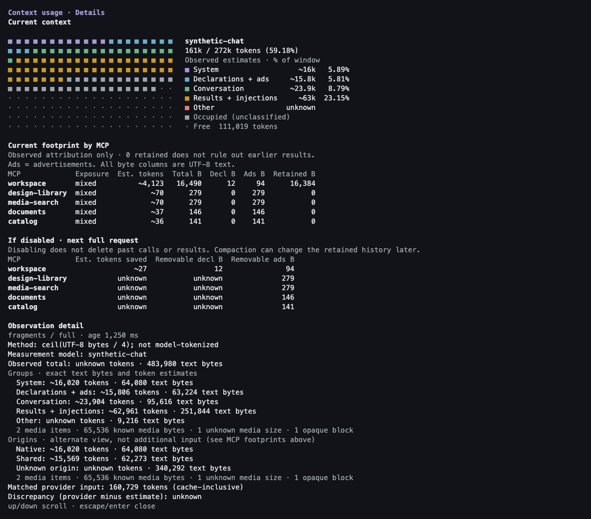

# pi-context

[](https://github.com/Gentleman-Programming/gentle-ai)

A read-only terminal dashboard for [Pi](https://pi.dev/). It answers two different questions:

| Question | What to look at |
| --- | --- |
| **What's taking up context now?** | `/gentle:context` shows projected window occupancy and free space, alongside estimates by category. In `/gentle:context all`, **Current footprint by MCP** breaks each server's observed subtotal into tool declarations, advertisements, and retained calls and results. |
| **What would I stop sending if I disabled an MCP server?** | In `/gentle:context all`, **If disabled · next full request** estimates what might go away and shows known removable components even when the total is unknown. Disabling a server does **not** delete past calls or results. |



*Dashboard preview with synthetic data. The image is hosted on GitHub, not bundled in the local archive.*

## Quick start: install for one project

With Git and Pi installed, clone the repository and keep the checkout in a stable location:

```sh
git clone https://github.com/Taber37/pi-context.git
```

From the project where you want to use the extension (not the extension checkout), replace the example path with the absolute path to your clone:

```sh
pi install -l /absolute/path/to/pi-context
```

Start Pi in that project and approve project trust if prompted, after reviewing the code and project configuration. If Pi is already running there, try `/reload`; if the command doesn't appear, restart Pi from the project and use `pi --resume` to pick up your session. Run `/gentle:context` for the overview or `/gentle:context all` for details. Use ↑/↓ to scroll and Esc or Enter to close (your Pi bindings apply). The first report can show projected occupancy before it has observed a request.

To uninstall, run from the same project with the same checkout path, then reload or restart Pi:

```sh
pi remove -l /absolute/path/to/pi-context
```

Pi references the checkout without copying it. Removal unregisters it from the project; it does not delete the checkout. See the [installation guide](docs/local-install.md) for the isolated Pi and Gentle Shell workflows.

## What the numbers mean

The dashboard keeps Pi's current projection separate from an observation of a recent request or logical transcript. Category and MCP token counts are estimates, not exact wire or billed tokens. The disable scenario assumes the observed tool configuration is otherwise unchanged; it excludes shared infrastructure and retained history. Compaction may change retained history later. Unknown savings or attribution are not zero, and zero attributed history does not prove there were no earlier results.

The extension inspects request or transcript data locally and keeps only aggregate counts, timestamps, and bounded display labels in memory, not raw prompts or results. The reports don't call a model, send telemetry, write extension state to disk, or modify MCP settings or session history. Pi's normal provider and session behavior is unchanged.

## Compatibility and distribution

- **Pi 1.7.0:** interactive dashboard exercised locally, including the detail view in a synthetic terminal session. Restart and resume confirmed for the overview; hot reload was not verified.
- **Pi 1.6.1:** isolated RPC install, report, and removal checks, including with the **Gentle Shell 4.9.0** launcher using Pi 1.6.1. RPC gets plain reports; print and JSON modes have no report UI. Other versions are unverified.

Public source on GitHub is not an npm release or a license grant. The manifest remains `private: true` and `UNLICENSED`, with `local-context-development` as its local build identifier. Do not install `pi-context` from npm; that name refers to a different project.
